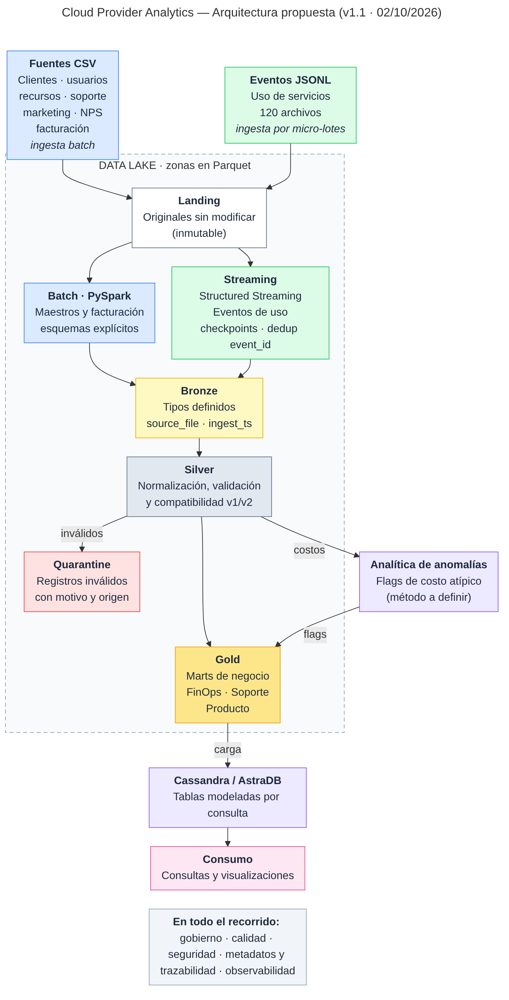

# Cloud Provider Analytics — TPE Big Data

Proyecto integrador de **72.80 Big Data** (ITBA, 2.º cuatrimestre 2026).

**Equipo:** 
- Santiago Manuel Devesa (64223) 
- Rosario Otegui (63708) 
- Alicia Cobo Iglesias (69568) 
- Ernest Elies Domingo (69613) 
- Francisco Varela (64447)

**Docente:** Prof. (Adj.) Diego Mosquera

**Estado actual del repositorio:** Segunda entrega parcial (en curso, rama `e2`)

## Objetivo

Pipeline ETL + streaming + serving para un proveedor de nube: integra clientes, recursos, facturación, soporte, marketing y eventos de uso para responder preguntas de FinOps, Soporte y Producto. Usa PySpark, Parquet y Apache Cassandra.

## Arquitectura

Patrón híbrido (batch + streaming) sobre un Data Lake de cuatro zonas en Parquet: Landing → Bronze → Silver → Gold, con publicación en Apache Cassandra (local en el runtime; ver `DECISIONS.md`).



Decisiones técnicas, alternativas y correcciones respecto de la primera entrega: [`DECISIONS.md`](DECISIONS.md).

## Ejecución del pipeline (Google Colab)

Entorno oficial: Google Colab (Python 3.13+, Java 17, PySpark 4.2.1; ver [`requirements.txt`](requirements.txt)).

1. Abrir [`notebooks/e2_pipeline_colab.ipynb`](notebooks/e2_pipeline_colab.ipynb) en Colab.
2. *Entorno de ejecución → Ejecutar todas*.

El notebook clona el repositorio, ejecuta [`infra/colab_setup.sh`](infra/colab_setup.sh) y luego:

```bash
python -m src.pipeline run                  # Landing → Bronze → Silver → Gold → Cassandra
python -m src.pipeline run --stage silver   # una sola etapa (también --from <etapa>)
python -m src.pipeline reset                # borra las zonas derivadas; Landing no se toca
```

Cada etapa deja su evidencia en [`evidence/e2/`](evidence/): un JSON por etapa con rutas, archivos, bytes, filas y duración, y el log de la corrida en `run.log`.

## Pruebas

```bash
python -m pytest -q tests
```

Detalle en [`tests/README.md`](tests/README.md).

## Ejecución local (opcional)

Requiere Python 3.13 y Java 17 o 21. La evidencia oficial es la de Colab.

```bash
python3.13 -m venv .venv
source .venv/bin/activate
pip install -r requirements.txt
export JAVA_HOME=$(/usr/libexec/java_home -v 21)   # macOS; en Linux, la ruta del JDK
python -m src.pipeline run
```

## Desarrollo local (informe y exploración)

```bash
python -m venv .venv
source .venv/bin/activate              # Windows PowerShell: .\.venv\Scripts\Activate.ps1
pip install -r requirements-dev.txt
```

| Qué | Cómo |
|---|---|
| Generar el PDF del informe | `python tools/docs/build_pdf.py` → `docs/build/entrega1.pdf` |
| Explorar los datos | `jupyter lab notebooks/` (ver [`notebooks/README.md`](notebooks/README.md)) |

## Limitaciones

Segunda entrega en curso.

| Componente | Estado |
|---|---|
| Entrypoint, logs y evidencia automática | Implementado |
| Bronze batch (`customers_orgs`, `users`, `resources`, `billing_monthly`) | Implementado y probado en Colab |
| Bronze streaming (`usage_events`) | Implementado y probado en Colab |
| Silver (eventos, `customers_orgs`, `resources`, quarantine) | Implementado y probado en Colab |
| Gold (`org_daily_usage_by_service` con anomalías de costo) | Implementado y probado localmente |
| Serving en Cassandra | Pendiente (la etapa termina con estado `pending`) |
| Diagrama de arquitectura | Versión 1.1 de la primera entrega; se actualiza al cerrar la implementación |
