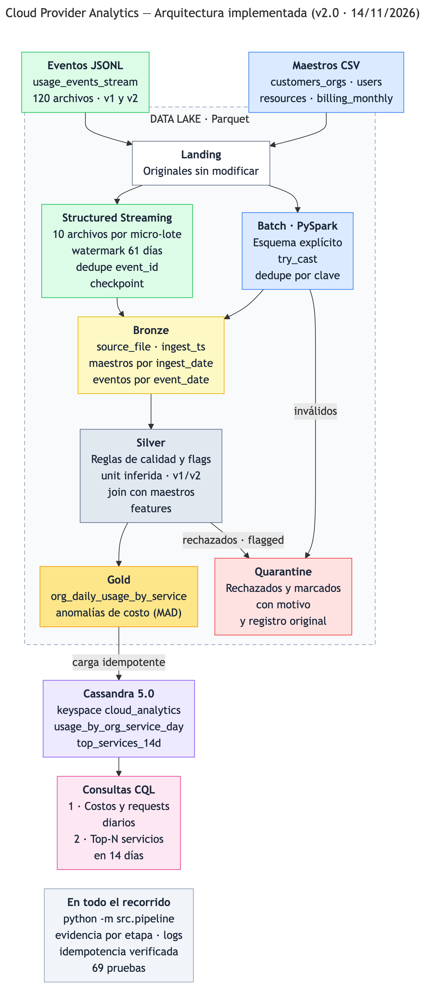

# Cloud Provider Analytics — TPE Big Data

Proyecto integrador de **72.80 Big Data** (ITBA, 2.º cuatrimestre 2026).

**Equipo:**
- Santiago Manuel Devesa (64223)
- Rosario Otegui (63708)
- Alicia Cobo Iglesias (69568)
- Ernest Elies Domingo (69613)
- Francisco Varela (64447)

**Docente:** Prof. (Adj.) Diego Mosquera

| Entrega | Documento |
|---|---|
| Primera: diseño | [`docs/Primera-Entrega.pdf`](docs/Primera-Entrega.pdf) |
| Segunda: implementación | [`docs/Segunda-Entrega.pdf`](docs/Segunda-Entrega.pdf) |

## Arquitectura



Decisiones técnicas: [`DECISIONS.md`](DECISIONS.md).

## Quickstart (Google Colab)

1. Abrir [`notebooks/e2_pipeline_colab.ipynb`](https://colab.research.google.com/github/smdevesa/tpe-big-data/blob/e2/notebooks/e2_pipeline_colab.ipynb) en Colab.
2. *Entorno de ejecución → Desconectar y borrar el entorno de ejecución*.
3. *Entorno de ejecución → Ejecutar todas*.

El notebook instala Java 17, las dependencias y Cassandra 5.0.4 ([`infra/colab_setup.sh`](infra/colab_setup.sh)), corre `python -m src.pipeline idempotency`, muestra las consultas CQL, corre las pruebas y descarga la evidencia.

| Celda | Esperado |
|---|---|
| Setup | `Cassandra lista en N s` |
| Pipeline | Las cinco etapas `ok` en las dos corridas e `idempotencia: ok` |
| Consultas | Consulta 1: 6 filas; consulta 2: 3 filas |
| Pruebas | `69 passed` |

## Resultados

| Etapa | Resultado |
|---|---|
| Bronze batch | `customers_orgs` 80, `users` 800, `resources` 400, `billing_monthly` 240 |
| Bronze streaming | 43.200 eventos en 12 micro-lotes; 39.599 fuera de orden aceptados, 0 descartados |
| Silver | 43.200 eventos; 0 rechazados; 211 costos anómalos en quarantine como `flagged` |
| Gold | 11.050 filas; 147.433,98 USD; 134 días con costo anómalo |
| Serving | 11.050 y 15.599 filas en Cassandra |
| Idempotencia | Segunda corrida sin lecturas del stream y con las mismas medidas en todas las zonas |

`(org_cvs4f8cg, 2025-08-17, networking)`: **4,8360 USD y 376 requests**. Evidencia en [`evidence/`](evidence/).

## Comandos

```bash
python -m src.pipeline run                  # todas las etapas (--stage X o --from X)
python -m src.pipeline reset                # borra zonas derivadas, checkpoints y keyspace
python -m src.pipeline idempotency          # reset + dos corridas + comparación
python -m pytest -q tests
```

| Tema | Detalle |
|---|---|
| Configuración | Variables de entorno con default: [`config/`](config/) |
| Logs | Un `run.log` por corrida; logs de Spark filtrados con [`infra/log4j2.properties`](infra/log4j2.properties) |
| Errores | Una etapa que falla queda `failed` en su JSON con el error y corta la corrida |
| Pruebas | 69 pruebas de lógica de negocio: [`tests/`](tests/) |

## Ejecución local

Requiere Python 3.13, Java 17 o 21 y Docker.

```bash
python3.13 -m venv .venv
source .venv/bin/activate
pip install -r requirements.txt
docker run -d --name tpe-cassandra -p 9042:9042 -e MAX_HEAP_SIZE=1G -e HEAP_NEWSIZE=256M cassandra:5.0.4
export JAVA_HOME=$(/usr/libexec/java_home -v 21)
python -m src.pipeline idempotency
```

## Estructura

| Carpeta | Contenido |
|---|---|
| [`src/`](src/) | Pipeline: una etapa por zona |
| [`tests/`](tests/) | Pruebas |
| [`infra/`](infra/) | Setup de Colab y Cassandra, CQL, logs de Spark |
| [`notebooks/`](notebooks/) | Ejecución en Colab y exploración de la primera entrega |
| [`datalake/landing/`](datalake/landing/) | Datos provistos (inmutables) |
| [`evidence/`](evidence/) | Evidencia de ejecución |
| [`docs/`](docs/) | Consigna y entregas (Markdown y PDF) |
| [`config/`](config/) | Variables de entorno |
| [`tools/docs/`](tools/docs/) | Compilación de las entregas a PDF |
