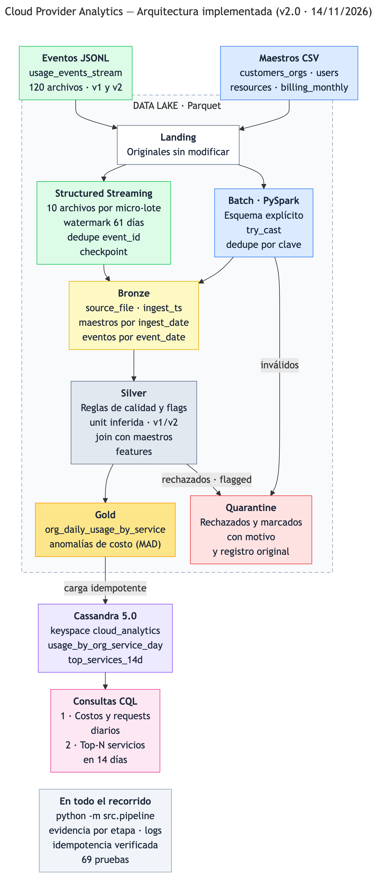

<div align="center">


# 72.80 - Big Data

**Segunda evaluación parcial**

Fecha de entrega: 16/11/2026

**Alumnos**

| Nombre | Legajo |
|---|---|
| Santiago Manuel Devesa | 64223 |
| Rosario Otegui | 63708 |
| Alicia Cobo Iglesias | 69568 |
| Ernest Elies Domingo | 69613 |
| Francisco Varela | 64447 |

**Profesores**

Diego Mosquera Uzcaregui

</div>

<!-- pagebreak -->

## 1. Arquitectura

{height=23cm}

<!-- pagebreak -->

## 2. Ingesta batch

| Fuente | Landing | Bronze | Quarantine | Partición |
|---|---:|---:|---:|---|
| `customers_orgs` | 80 | 80 | 0 | `ingest_date` |
| `users` | 800 | 800 | 0 | `ingest_date` |
| `resources` | 400 | 400 | 0 | `ingest_date` |
| `billing_monthly` | 240 | 240 | 0 | `month` |

Esquema explícito, `try_cast`, `source_file` e `ingest_ts`, deduplicación por clave. Se verifica `Landing = Bronze + quarantine + duplicados`.

## 3. Ingesta streaming

| Métrica | Valor |
|---|---:|
| Archivos / micro-lotes | 120 / 12 |
| Eventos en Bronze | 43.200 |
| v1 / v2 | 10.800 / 32.400 |
| Duplicados por `event_id` descartados | 0 |
| Descartados por watermark | 0 |
| Eventos fuera de orden aceptados | 39.599 (91,7 %) |
| Atraso máximo | 59 d 23 h 54 min |

Esquema explícito, watermark de 61 días sobre `event_ts`, `dropDuplicatesWithinWatermark` por `event_id`, checkpoint y trigger `availableNow`. Cada archivo mezcla eventos de los 60 días del dataset:

| Delay del watermark | Descartados | Escritos |
|---|---:|---:|
| 7 días | 31.811 | 11.389 |
| 61 días | 0 | 43.200 |

## 4. Silver y calidad

| Regla | Tratamiento | Casos |
|---|---|---:|
| `event_id` no nulo | Quarantine | 0 |
| `event_id` único | Quarantine | 0 |
| Evento atribuible (JSON válido, `timestamp`, `org_id`, `service`) | Quarantine | 0 |
| `unit` no nulo cuando existe `value` | Se infiere de la métrica; si no se puede, quarantine | 2.038 resueltos |
| `cost_usd_increment >= -0,01` | Flag `cost_anomaly` y copia a quarantine | 211 |

| Flag | Casos |
|---|---:|
| `value_missing` | 877 |
| `unit_inferred` | 2.075 |
| `before_resource_created` | 7.371 |
| `unknown_schema_version` | 0 |

43.200 eventos en Bronze, 43.200 en Silver, 0 rechazados, 211 en quarantine como `flagged`. Join con `customers_orgs` y `resources`: 0 eventos sin coincidencia.

### Muestra de quarantine

| `event_id` | Fecha | Organización | Servicio | Costo | Motivo |
|---|---|---|---|---:|---|
| `evt_0mv15gk8xuga` | 2025-08-08 | `org_53lc58dr` | genai | −0,1854 | `cost_below_threshold` |
| `evt_0s3r8qeziv84` | 2025-07-08 | `org_5lxo6qji` | database | −5,1627 | `cost_below_threshold` |
| `evt_11kvg2do2pr9` | 2025-07-09 | `org_teiyzcot` | compute | −5,4733 | `cost_below_threshold` |

### Features

| Feature | Eventos con valor | Total |
|---|---:|---:|
| `requests` | 19.113 | 2.294.079 |
| `cpu_hours` | 10.497 | 19.833,04 |
| `storage_gb_hours` | 12.713 | 131.288,13 |
| `genai_tokens` | 3.132 | 2.558.359 |
| `carbon_kg` | 32.400 | 367,50 |

## 5. Gold y analítica

| `org_daily_usage_by_service` | Valor |
|---|---:|
| Filas | 11.050 |
| Organizaciones / series (org, servicio) | 80 / 262 |
| Costo total | 147.433,98 USD |
| Requests | 2.294.079 |
| `(org_cvs4f8cg, 2025-08-17, networking)` | 4,8360 USD · 376 requests |

Anomalías de costo: z-score robusto `0,6745 × (costo − mediana) / MAD` por organización y servicio, umbral |z| > 3,5.

| Resultado | Valor |
|---|---:|
| Días anómalos | 134 (1,2 %) |
| Altos / bajos | 124 / 10 |

| Día | Organización | Servicio | Costo | Mediana | z |
|---|---|---|---:|---:|---:|
| 2025-07-03 | `org_okep7y6w` | compute | 202,65 | 11,14 | 47,0 |
| 2025-07-09 | `org_x7eedtjv` | compute | 311,26 | 13,90 | 45,8 |
| 2025-08-07 | `org_okep7y6w` | compute | 191,90 | 11,14 | 44,4 |

## 6. Serving en Cassandra

Keyspace `cloud_analytics` (`SimpleStrategy`, RF 1). Carga con `cassandra-driver` desde `foreachPartition`; `INSERT` es upsert por clave primaria.

| Tabla | Clave primaria | Filas |
|---|---|---:|
| `usage_by_org_service_day` | `((org_id, service), usage_date)` | 11.050 |
| `top_services_14d` | `((org_id, as_of_date), rank)` | 15.599 |

**Consulta 1.** Costos y requests diarios por organización y servicio en un rango de fechas.

```sql
SELECT usage_date, daily_cost_usd, requests, events, events_missing_value, is_cost_anomaly
FROM cloud_analytics.usage_by_org_service_day
WHERE org_id = 'org_cvs4f8cg' AND service = 'networking'
  AND usage_date >= '2025-08-11' AND usage_date <= '2025-08-17';
```

| usage_date | daily_cost_usd | requests | events | sin value | anomalía |
|---|---:|---:|---:|---:|---|
| 2025-08-17 | 4,8360 | 376 | 6 | 1 | no |
| 2025-08-15 | 0,3375 | — | 3 | 0 | no |
| 2025-08-14 | 2,8991 | 325 | 6 | 0 | no |
| 2025-08-13 | 2,3951 | 238 | 3 | 0 | no |
| 2025-08-12 | 1,3664 | 125 | 3 | 0 | no |
| 2025-08-11 | 0,3315 | — | 6 | 0 | no |

**Consulta 2.** Top-N servicios por costo acumulado en los últimos 14 días para una organización.

```sql
SELECT rank, service, cost_14d_usd, days_with_usage, window_start
FROM cloud_analytics.top_services_14d
WHERE org_id = 'org_cvs4f8cg' AND as_of_date = '2025-08-31'
LIMIT 3;
```

| rank | service | cost_14d_usd | días con uso | desde |
|---:|---|---:|---:|---|
| 1 | genai | 137,0204 | 7 | 2025-08-18 |
| 2 | analytics | 85,8359 | 5 | 2025-08-18 |
| 3 | compute | 58,0855 | 6 | 2025-08-18 |

## 7. Idempotencia

`python -m src.pipeline idempotency`: `reset`, dos corridas y comparación del estado guardado.

| Zona | Medida | Corrida 1 | Corrida 2 |
|---|---|---:|---:|
| Bronze maestros | Filas | 1.520 | 1.520 |
| Streaming | Filas leídas | 43.200 | 0 |
| Bronze eventos | Filas = `event_id` distintos | 43.200 | 43.200 |
| Silver | Filas = `event_id` distintos | 43.200 | 43.200 |
| Quarantine | Rechazados / flagged | 0 / 211 | 0 / 211 |
| Gold | Filas = claves distintas | 11.050 | 11.050 |
| Cassandra | Filas por tabla | 11.050 / 15.599 | 11.050 / 15.599 |

## 8. Gobierno preliminar

| Aspecto | Implementación |
|---|---|
| Controles | Encabezado y conteos en Bronze; reglas en Silver; `Bronze = Silver + rechazados`; grano único y conciliación Silver–Gold; filas en Cassandra = origen. Si un control falla, la etapa se detiene |
| Metadatos | `source_file`, `ingest_ts` (Bronze y Silver); `reason`, `raw`, `action` (quarantine); `processed_at` (Gold y Cassandra) |
| Linaje | Landing → Bronze → Silver → Gold → Cassandra, una etapa por zona, cada una con entradas y salidas registradas |
| Acceso | Sin credenciales en el repositorio; Landing de solo lectura; configuración por variables de entorno |
| Evidencias | Un JSON por etapa, `run.log` por corrida, `cql_results.txt`, `idempotency.json`, `pytest.txt` |

| Integrante | Responsable de | Apoyo en |
|---|---|---|
| Santiago Manuel Devesa | Ingesta batch y pruebas | Streaming |
| Rosario Otegui | Silver y calidad | Gold |
| Alicia Cobo Iglesias | Streaming | Silver |
| Ernest Elies Domingo | Gold y anomalías | Serving |
| Francisco Varela | Serving y documentación | Ingesta batch |

## 9. Pruebas y reproducibilidad

| Aspecto | Implementación |
|---|---|
| Puesta en marcha | `notebooks/e2_pipeline_colab.ipynb` en Google Colab: *Ejecutar todas* |
| Entorno | Python 3.13, Java 17, PySpark 4.2.1, `cassandra-driver` 3.30.1, Cassandra 5.0.4 |
| Comandos | `python -m src.pipeline run`, `reset`, `idempotency` |
| Configuración | Variables de entorno con default (`config/.env.example`) |
| Logs | Formato único del proyecto, un `run.log` por corrida |
| Manejo de errores | Una etapa que falla queda `failed` con el error y corta la corrida |
| Pruebas | 69 pruebas de lógica: casts, quarantine, dedupe, watermark, reglas, agregación, MAD, ranking e idempotencia |

## 10. Decisiones

| Tema | Decisión |
|---|---|
| Patrón | Híbrido: batch para maestros, Structured Streaming para eventos |
| Particiones | Maestros por `ingest_date`, facturación por `month`, eventos por `event_date`, Gold por `usage_date` |
| Claves de Cassandra | `((org_id, service), usage_date)` y `((org_id, as_of_date), rank)` |
| Umbrales | Costo válido si ≥ −0,01; anomalía si \|z\| > 3,5; watermark de 61 días |
| Serving | Cassandra en lugar de AstraDB, por mayor familiaridad del equipo |

Registro completo en `DECISIONS.md`.

<!-- pagebreak -->

## 11. Backlog

### Obligatorio

| Paquete de trabajo | Resultado | Responsable | Horas |
|---|---|---|---:|
| Ingesta batch del resto de las fuentes | `support_tickets`, `marketing_touches` y `nps_surveys` en Bronze | Santiago | 3 |
| Silver de facturación y soporte | `billing_monthly`, `support_tickets` y `users` conformados | Rosario | 6 |
| Decisiones diferidas | Eventos anteriores a la creación del recurso y `credits` vacío | Rosario | 2 |
| Mart de Producto | `genai_tokens_by_org_date` | Alicia | 3 |
| Marts de FinOps y Soporte | `revenue_by_org_month` y `tickets_by_org_date` | Ernest | 5 |
| Mart de anomalías | `cost_anomaly_mart` | Ernest | 2 |
| Consultas 3 a 5 | Tablas y CQL de tickets críticos, revenue mensual y tokens GenAI | Francisco | 4 |
| Calidad y gobierno | Reglas de las fuentes nuevas, metadatos, linaje y observabilidad | Rosario y Alicia | 3 |
| Pruebas | Reglas, marts y consultas nuevas; README validado en entorno limpio | Santiago | 2 |
| Documentación y defensa | Diccionario de datos, diagrama final, presentación, video y demo | Francisco | 3 |
| **Total** | | | **33** |

### Deseable

| Tarea | Responsable |
|---|---|
| Recalcular Silver y Gold solo para las fechas con datos nuevos | Rosario |
| Ventana móvil para el MAD | Ernest |
| Guardar aparte los eventos descartados por watermark | Alicia |
| Compactar los archivos chicos de Bronze streaming | Alicia |
| Retención de las fotos diarias de maestros | Santiago |

### Fuera de alcance

| Tema | Motivo |
|---|---|
| Cassandra multi-nodo con replicación | Un nodo alcanza para el volumen del dataset |
| Orquestador de tareas | El pipeline se ejecuta con un comando |
| Dashboards de visualización | La consigna pide consultas desde Cassandra |
